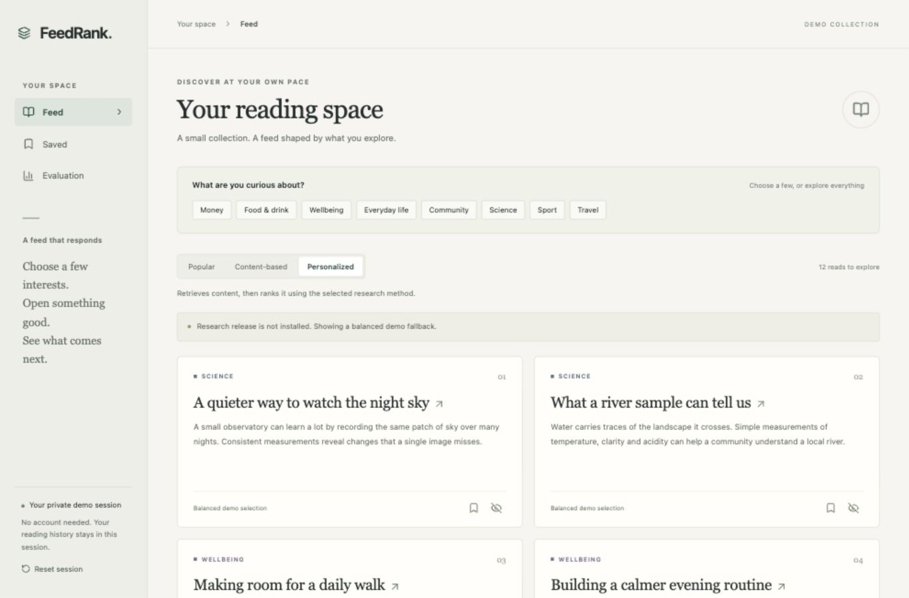

# FeedRank

A compact content recommendation service: a reading feed, saved reads, session feedback,
and an evaluation view. Python, PyTorch, scikit-learn, FastAPI, SQLite, React and TypeScript.

**Current status:** the application works with an explicit content-based demo fallback.
The full training/evaluation pipeline passes an isolated synthetic integration run.
MIND research training and final benchmark evaluation require dataset access and have
not run yet. No MIND quality numbers are claimed. See [evaluation status](reports/evaluation.md).



## Run locally

Python 3.12 and Node 22 are recommended.

```sh
python3.12 -m venv .venv
source .venv/bin/activate
make install web serve
```

Open http://127.0.0.1:8000. The API documentation is at `/docs`; `/health` checks the
process and `/ready` checks the research release. Missing artifacts intentionally
return 503 at `/ready` while the clearly labelled demo fallback remains usable.

```sh
docker compose up --build -d
# Open http://127.0.0.1:8080
python scripts/http_smoke.py http://127.0.0.1:8080
docker compose down
```

Session storage survives container restarts in a named volume. A reset clears only
the current session. No registration, email or external article source is required.

## Data and research commands

Read the [MIND license](https://github.com/msnews/MIND/blob/master/MSR%20License_Data.pdf)
and obtain authorized access at the [official-site-linked mirror](https://huggingface.co/datasets/yjw1029/MIND).
Its free account gate currently requires accepting dataset terms. If using a token,
set `HF_TOKEN` locally; never commit it. Alternatively place the two official small
archives at `data/train.zip` and `data/holdout.zip`.

```sh
make download prepare train evaluate release
make serve
```

`download` records hashes and extracts only the two TSV files. `prepare` audits the
schema, time ranges, duplicates, labels, unknowns and split overlaps. `train` runs
three CPU epochs, checkpoint selection and a separate ranker fit. `evaluate` freezes
C selection before opening official validation and writes `reports/metrics.json` and
`reports/evaluation.md`. `release` creates a checksum-linked bundle for public demo
serving. After release, restart the API to load the new version.

The first final evaluation writes `reports/holdout.lock`. Do not remove it to tune
against the same holdout. A subsequent experiment needs a new stated protocol.
Seeded execution is tested on a CPU fixture; bitwise equality across platforms is
not promised. Full MIND runtime and quality have not yet been measured.

## Model and evaluation

The item tower pools trainable word embeddings from title/summary and category /
subcategory embeddings into a normalized 64-dimensional vector. The user tower
combines up to 20 earlier reads, with a learned empty-history representation. Four
observed non-clicks within each impression form contrastive training negatives.

Exact top-50 search precedes a logistic ranker with tower similarity, TF-IDF similarity,
category affinity, frozen smoothed popularity and history length. Baselines are
popularity and TF-IDF/category content matching. A category-cap policy is measured
separately. The method selected on C is used for research serving; there is no promised
ranker gain. Live feedback updates session features, not model weights.

[Protocol](reports/protocol.md): temporal A/B/C with an internal A checkpoint window;
official validation used as final holdout, not an official test. Logged-impression
NDCG@10, NDCG@5, first-positive MRR and group AUC use the complete candidate set.
Catalog Recall@50 is a separate first-observed-time replay, restricted to a fixed
200-group subset. User-cluster bootstrap intervals, warm/empty/short/new-item slices,
exposure and ablations are included in the evaluator.

## Public content and limitations

The 48 demo summaries are original evergreen content, **not live news**. MIND article
text and logs are not shipped. Demo articles have no measured audience popularity;
`Popular` therefore uses a tied smoothed prior and balanced selection. Selected
interests are explicit category signals, not a claim of a learned causal explanation.
Offline research quality does not establish quality on this public catalog.

Non-clicks do not prove dislike. Candidate order in MIND is shuffled. There is no
position/propensity correction or claim of online CTR, retention or business impact.
SQLite and the rate limiter target a small, single-process demo, not a large service.

## Verification and handoff

```sh
make test smoke web
python scripts/http_smoke.py
python scripts/benchmark.py
```

The smoke run trains twice on a disposable synthetic fixture, checks reproducibility,
loads the trained release into the API and verifies changed user features. It never
publishes fixture metrics as research results. Tests cover metric edge cases, safe
serialization, masked padding, novel content, temporal groups, session isolation,
concurrent event retries, reset and corrupt artifacts. CI also builds the container
and runs an HTTP smoke without downloading MIND.

- [Engineering decisions](reports/decisions.md)
- [Deployment and rollback](deploy/README.md)
- [Portfolio text and video script](reports/portfolio.md)
- [Interview notes](reports/interview.md)
- [Data provenance and license](reports/data-access.md)

Code: MIT. MIND is governed by separate Microsoft Research License Terms.
